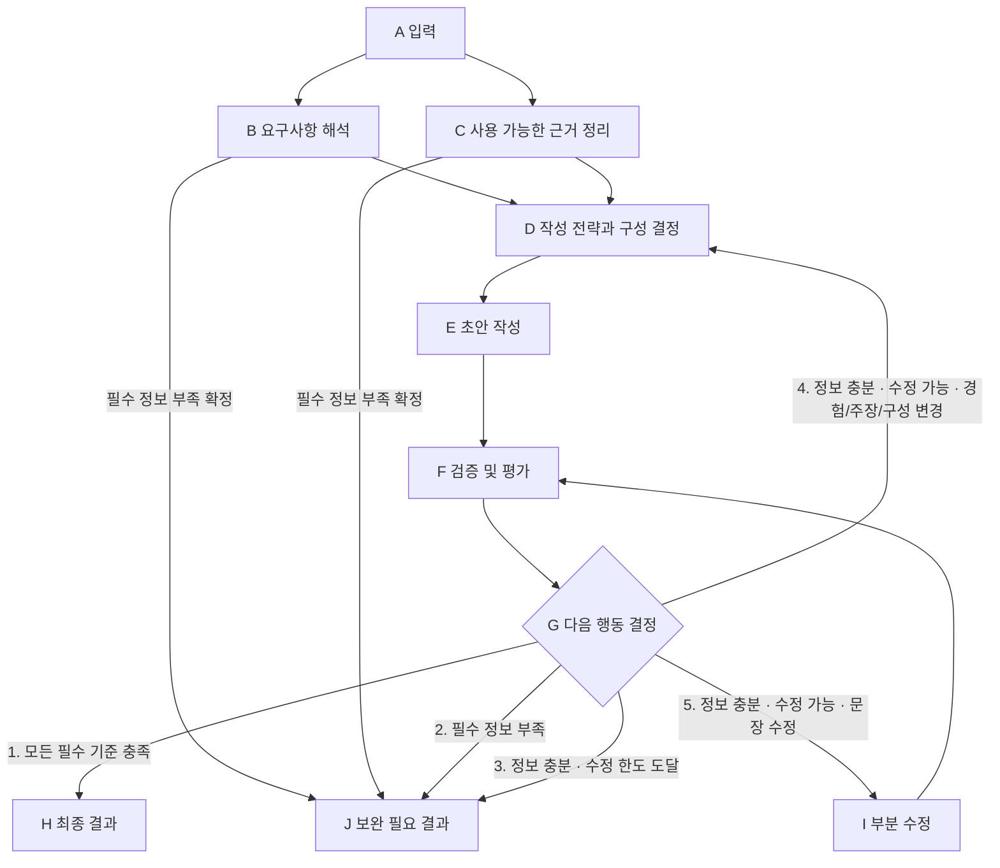

# 자기소개서 흐름의 노드별 최소 명세

- 결정일: 2026-10-20 / 상태: ESSAY-21 공통 계약 구현·검증 완료. 업무 노드와 전체 흐름은 후속 구현 기준.
- 기준: 사용자가 제공한 A~J 흐름. [PRD](PRD_V2.md) · [기술 설계](TECH_DESIGN_V2.md) · [작업·소유권](BACKLOG_V2.md) · [QA 계획](qa-v2.md)
- 완료된 ESSAY-19 공통 기반과 ESSAY-10 조사 기능을 확장한다. 계획·평가·분기 공통 계약은 ESSAY-21에서 구현했다. [실제 API·인계](FLOW_CONTRACTS.md)와 [검증 결과](qa-evidence/assignment/flow-foundation/verification.md)를 따른다. 아래 노드의 업무 알고리즘은 후속 단계다.

## 1. 이번에 정하는 것

각 단계가 받는 자료, 내보내는 결과, 다음 단계로 넘어갈 조건과 종료 조건을 정한다. 경험 순위 산정, 문단 전개 기법, 세부 프롬프트, 평가 점수·가중치는 후속 설계로 남긴다. 필수 기준을 실제로 검사하는 기능은 첫 구현부터 필요하다.

도표의 상자는 논리적 책임이다. 상자마다 별도 모델을 호출하지 않는다. 모델 역할은 기업·직무 조사, 경험·문항 분석, 작성, 검토의 네 가지를 유지한다. B와 C의 개인 근거 추출은 분석 모델의 한 응답을 공유하고, C의 기업 조사는 기존 MCP 역할을 활용한다. D는 검증된 후보와 요구사항을 계획 계약으로 조립하는 코드 단계로 시작한다. 별도 계획 모델을 추가하지 않는다. 실제 LangGraph 노드 배치는 ESSAY-14가 담당하며 합류·분기 의미를 보존한다.

도표 밖의 입력 오류·제공자 장애·시간 초과·취소는 공통 오류/취소 경로로 종료한다. B/C에서 보완이 확정되면 초안을 만들지 않는다. D에서 필수 정보 부족을 뒤늦게 확인해도 J로 종료한다. 자료가 충분한데 유효한 계획을 만들지 못한 경우는 품질 실패이며 정보 부족으로 꾸미지 않는다.

## 2. 공통 자료와 경계

아래 명칭은 의미를 설명하는 계약명이다. 실제 Python 필드·스키마는 [ESSAY-21 인계](FLOW_CONTRACTS.md)에서 확정했고 기존 ESSAY-10 반환 계약과 호환한다.

| 자료 | 최소 내용 | 변경 규칙 |
| --- | --- | --- |
| 입력 스냅샷 | 기업·직무·문항·경험, 선택 공고, 요청 ID | A 이후 불변. LF 정규화와 Unicode 코드 포인트를 사용 |
| 요구사항 | ID, 요구 내용, 필수 여부, 확인할 조건, 관련 경험 후보 ID | B가 생성. 명시되지 않은 조건을 필수로 만들지 않음 |
| 근거 묶음 | 개인 원문 인용·위치·ID, 검증된 회사 사실/직무 요건·출처 ID, 부족 항목 | C가 구성. 회사 사실과 개인 사실을 별도 보관 |
| 작성 계획 | 버전, 사용할 근거 ID, 주장 종류와 근거 연결, 요구사항별 대응, 문단 ID·목적·순서·분량 배분 | D가 생성. 초안 본문이나 숨은 사고 과정이 아닌 짧은 구조화 결과 |
| 초안 묶음 | 버전, 계획 버전, 전체 초안, 문단 ID/범위, claimMap, fitReasons | E/I가 생성. 원문·근거·이전 결과를 덮어쓰지 않음 |
| 평가 결과 | 평가한 초안/계획 버전, 필수 기준별 pass/fail, 지적·범위·수정 지시·필수 정보 부족 여부 | F가 생성. 평가하지 않은 항목은 통과로 간주하지 않음 |
| 제어 상태 | 공통 수정 횟수 0 또는 1, 종료 사유, 호출/토큰 예산, deadline | 코드가 관리. 모델 출력이 수정 한도·예산을 늘릴 수 없음 |

근거 인용은 원문과 정확히 대조한다. 사용자 과거 사실은 원문의 완전한 문장을 선택해 표현·순서를 보존한다. 회사 사실을 사용자 성과로 바꾸거나, 현재 해석·미래 계획을 이미 겪은 사실처럼 쓰지 않는다. 검증된 인재상은 관련될 때만 활용하며 문항·해당 직무 요구를 우선한다.

## 3. 노드별 최소 책임

| 노드 | 받는 것 | 반드시 하는 일 | 내보내는 것·진행 조건 |
| --- | --- | --- | --- |
| A 입력 | 네 필수 입력·선택 공고 | 입력 형식·길이 검증, 요청별 스냅샷·예산·deadline 생성 | 유효 입력 → B/C. 잘못된 입력 → 400 |
| B 요구사항 해석 | 문항·직무·경험 | 문항에서 답해야 할 내용과 필수 조건 구분. 경험 원문 근거 및 요구사항과 연결할 후보를 구조화 | 요구사항·개인 근거 후보·부족 항목. 필수 정보 부족 확정 시 J |
| C 사용 가능한 근거 정리 | 기업·직무·선택 공고, 같은 분석 응답에서 추출한 개인 근거 | 기존 ESSAY-10 조사 결과와 개인 근거를 합침. 출처·ID·원문 위치 검증. 자료가 없다는 사실도 표시 | 검증된 근거 묶음·부족 항목. 회사 식별/핵심 직무·경험 근거 부족 시 J |
| D 작성 전략과 구성 결정 | B/C의 검증 결과, 수정 시 F의 지적·이전 계획 | 유효한 후보로 최소 계획 조립. 선택한 경험·주장·문단이 어떤 필수 요구와 근거를 따르는지 연결. 수정 시 해당 선택/구성 갱신 | 검증 가능한 작성 계획 → E. 입력 정보 부족 → J. 계획 자체의 무효는 통과 금지 |
| E 초안 작성 | 입력 스냅샷·근거 묶음·D의 계획 | 계획에 따라 본문 작성. 개인 사실/회사 사실/해석/계획 구분. 근거 ID와 문단 연결 유지 | 초안·claimMap·fitReasons·버전 → F. 계획을 바꿀 필요가 있어도 몰래 변경하지 않음 |
| F 검증 및 평가 | 최신 초안·계획, 원문·출처·요구사항 | 전체 초안에 코드 검사와 독립 모델 검토. 문제마다 수정 범위와 부족한 정보를 구체적으로 표시 | 동일 버전의 필수 검사 결과·지적·수정 지시 → G |
| G 다음 행동 결정 | F의 결과·공통 수정 횟수·남은 예산 | 아래 순서대로 코드로 단 하나의 경로 선택 | H / J / D / I 중 하나. 분기 사유 기록 |
| I 부분 수정 | 최신 초안·문단/주장 ID·F의 지적·고정된 계획 | 허용된 문장 범위만 수정하고 전체 초안 재조립. 계획·경험 선택·사실 원문을 바꾸지 않음 | 전체 초안·갱신한 claimMap·새 버전 → F. 일부 문장만 검사하고 종료하지 않음 |
| H 최종 결과 | 최신 초안에 대한 모든 필수 기준 통과 결과 | 검토한 버전과 반환할 버전의 일치 확인 | ready 200: 801~1,000자 초안·출처·근거·생성 당시 검토 표시 |
| J 보완 필요 결과 | 필수 정보 부족 또는 해결되지 않은 품질 문제 | 종료 원인에 맞는 결과 제공. 검토 실패 초안을 최종 결과로 표시하지 않음 | 정보 부족은 needs_input 200. 정보 충분·수정 한도 등 품질 실패는 error 422 |

B의 문항 해석과 개인 근거 추출은 한 번의 분석 호출에서 처리한다. 기업 조사는 이 호출과 병렬 수행한다. C의 근거 묶음과 B의 요구사항이 모두 준비된 뒤 D를 한 번만 실행한다. 한쪽에서 보완/실패가 확정되면 다른 쪽의 새 호출을 막고 가능한 진행 작업을 취소한다. 경험·문항은 MCP나 외부 검색에 보내지 않는다.

## 4. F에서 반드시 확인할 기준

| 기준 | 통과 조건 | 검사 방법 |
| --- | --- | --- |
| 계약·근거 연결 | 모든 참조 ID·인용 위치·초안 구절·계획/초안 버전이 유효 | 코드 검사 |
| 개인 사실성 | 선택된 과거 사실 문장의 표현·순서 보존, 입력에 없는 경력·행동·수치·시점·성과 추가 없음 | 원문 대조 코드 + 의미 검토 |
| 회사 사실성 | 사용한 회사 주장/직무 요건이 검증된 회사 근거에 연결, 사용자 제공 자료는 별도 표시 | 출처/ID 검사 + 의미 검토 |
| 문항 충족 | B에서 확정한 필수 요구에 실제 답변이 있음 | 요구사항별 근거와 본문 대조 |
| 직무 연결 | 경험 근거와 실제 직무 요건의 연결이 설명됨. 관련 없는 인재상 끼워 넣기 없음 | fitReasons·본문 의미 검토 |
| 분량 | LF 정규화 후 공백 포함 801~1,000 Unicode 코드 포인트 | 서버 코드 검사 |
| 표현 구분 | 현재 해석·미래 계획을 과거 사실로 서술하지 않음 | 주장 종류 대조 + 의미 검토 |

모든 필수 기준을 통과해야 H로 간다. 모델 pass는 코드 검사 실패를 덮을 수 없다. 문체 선호나 가산점, 점수·가중치는 아직 필수 기준이 아니다. 모델 검토 통과는 사실성의 완전한 증명이나 합격 보장이 아니며 실제 사례와 작성자 대조는 ESSAY-17에서 별도 수행한다.

## 5. G의 분기 우선순위

| 순서 | 조건 | 경로·결과 |
| --- | --- | --- |
| 1 | 최신 초안의 모든 필수 기준 통과 | H. 수정 횟수가 1이어도 통과 결과를 반환 |
| 2 | 필수 기준 미충족 + 해결에 필수적인 정보가 실제로 없음 | J: needs_input, 필요한 입력·질문·기존 reasonCode |
| 3 | 기준 미충족 + 정보 충분 + 공통 수정 횟수 1 | J: QUALITY_CHECK_FAILED 또는 길이만 실패 시 LENGTH_VALIDATION_FAILED, 422 |
| 4 | 기준 미충족 + 정보 충분 + 수정 횟수 0 + 경험 선택/주장/문단 구성 변경 필요 | 수정 기회 예약 → D → E → F → G |
| 5 | 기준 미충족 + 정보 충분 + 수정 횟수 0 + 허용 문장 범위의 변경으로 해결 가능 | 수정 기회 예약 → I → F → G |

여러 문제가 섞이면 필수 정보 부족이 먼저이며, 정보가 충분하면 구성/주장 변경 경로가 문장 수정 경로보다 우선한다. `정보 충분`은 해결에 필요한 사실이 근거 묶음 안에 있다는 뜻이다. 문장이 어색하거나 글자 수가 넘친다는 이유만으로 새 사용자 정보를 요구하지 않는다.

F는 각 지적에 기준 ID, 문제 구절/문단·주장 ID, 원인, `missing_info / plan_or_claim / wording` 수정 범위, 구체적 수정 지시를 제공한다. 모든 실패가 wording이고 수정 가능 범위가 분명할 때만 I를 허용한다. 새로운 사실/주장·경험 교체나 사실 원문 문장의 추가/제외는 D 경로다. 분류할 수 없는 지적이나 유효하지 않은 수정 범위는 오류로 종료하며 임의로 통과시키거나 추측해서 수정하지 않는다.

## 6. 공통 수정 한도와 부분 수정

- 최초 D/E/F는 수정 횟수 0이다. G가 D 재진입 또는 I 중 하나를 선택할 때 수정 기회를 먼저 원자 예약해 1로 바꾼다.
- D와 I가 같은 기회 1회를 공유한다. D 재진입 시 횟수를 초기화하지 않는다. 사실성·문항·길이에 별도 기회를 주지 않는다.
- 수정 중 B/C와 기업 조사는 다시 실행하지 않는다. 새 정보가 필요하면 J로 종료하고 사용자 보완 후 새 요청에서 처리한다.
- I는 계획과 사실 문장을 고정한다. 범위를 벗어난 패치·중복/겹친 범위·과거 버전에 대한 수정은 적용하지 않는다. 임의 전체 재작성으로 대체하지 않는다.
- E/I 후 이전 F 결과는 무효다. 전체 초안의 근거·문항·직무·분량·사실성을 다시 검사한다. 문장을 줄였더라도 전체 검토를 생략하지 않는다.
- 수정 중 오류·시간 초과에도 이미 예약한 호출/수정 기회를 환급하지 않는다. 세 번째 작성·검토나 자동 강제 통과는 없다.

## 7. 모델·시간·오류 경계

| 경로 | 모델 호출 | 규칙 |
| --- | --- | --- |
| 최초 통과 | 조사 1 + 분석 1 + 작성 1 + 검토 1 = 4 | B/C 자료 일부는 한 분석 응답을 공유. D/G/A/H/J는 추가 모델 호출 없음 |
| D로 복귀 | 최초 4 + 수정 작성 1 + 재검토 1 = 최대 6 | D의 계획 갱신은 코드로 처리, 추가 계획/조사 모델 없음 |
| I 부분 수정 | 최초 4 + 부분 수정 작성 1 + 재검토 1 = 최대 6 | 전체 평가 F를 다시 수행 |
| 조기 보완/오류 | 실행한 호출만 사용, 최대 6 이내 | 불필요한 작성·검토 호출 차단 |

기존 상한을 유지한다: 모델당 30초, 조사 전체 45초, 요청 전체 180초, 클라이언트 195초, 모델 출력 합계 18,000토큰, 자동 재시도 0. 조사 MCP 내부 모델 1회도 총량에 포함하고 내장 도구 용량 2회를 선예약한다. 내부 검색어/페이지 수를 통제했다고 주장하지 않는다.

이 상한은 각 단계를 끝까지 실행할 시간 보장이 아니다. 남은 시간이 부족하면 기존 timeout/예산 오류로 종료하며 품질 실패나 정보 부족으로 바꾸지 않는다. 제공자·파싱·취소 실패도 별도 운영 오류다. D를 별도 모델로 바꾸려면 정상 5회/구성 수정 최대 8회까지 필요한 정책·deadline·토큰·스키마·QA를 먼저 별도 변경해야 한다. 이번 최소 명세는 그 변경을 승인하거나 구현하지 않는다.

J는 화면상의 종료 지점이다. 정보가 충분한데 수정 한도를 소진한 결과는 기존 needs_input 계약의 missingFields/questions를 지어내지 않고 422 품질 오류로 표현한다. 화면은 “추가 정보 필요”와 “이번 생성에서 기준 미충족”을 구분하고 입력·이전 결과를 보존한다. 모든 오류 응답은 원문·미검토 초안·키·전체 프롬프트를 노출하지 않는다.

## 8. 필수 검증 사례와 후속 상세 설계

아래는 구현 후 수행할 시험 목록이며 이번 문서 작업의 실행 결과가 아니다.

| ID | 조건 | 관찰할 결과 |
| --- | --- | --- |
| NF-01 | 모든 기준 최초 통과 | G1 → H, 모델 4회 |
| NF-02 | 필수 정보 부족, B/C 조기 발견 또는 F에서 발견 | J needs_input, 불필요한 작성/수정 없음 |
| NF-03 | 정보 충분·수정 1회 후 여전히 실패 | G3 → J 422, 세 번째 작성 없음 |
| NF-04 | 정보 충분·경험/주장/구성 변경 필요 | G4 → D/E → 전체 F, 수정 횟수 1·최대 모델 6회 |
| NF-05 | 정보 충분·문장만 수정 가능 | G5 → I → 전체 F, 계획·사실 문장 보존·최대 모델 6회 |
| NF-06 | 여러 종류의 지적 동시 존재 | 정보 부족 우선, 그다음 D 우선. D/I 연속 사용 금지 |
| NF-07 | 수정 횟수 1에서 모든 기준 통과 | G1 → H. 한도만 보고 실패시키지 않음 |
| NF-08 | 잘못된 ID/수정 범위·오래된 버전·분류 불가 | 적용/ready 차단, 계약 오류. 숨은 재시도 없음 |
| NF-09 | I로 분량을 고친 뒤 다른 근거/문항 기준 실패 | 최신 전체 F 결과로 재판정, 이전 pass 재사용 금지 |
| NF-10 | timeout·모델/MCP 장애·취소·동시 요청 | 운영 오류/취소 종료, 요청 격리·호출/수정 예약 무환불 |

나중에 구체화할 내용은 B의 문항 유형별 분석 방법, C의 근거 요약 방식, D의 경험 선택 우선순위·주장 설계·문단 전개/분량 최적화, E/I의 문체·부분 수정 프롬프트, F의 의미 평가 방법·점수·가중치다. 별도 모델 추가·수정 횟수 변경·사실 재서술 허용은 상세 조정과 구분하고 명시적 정책 변경 및 재검증을 거친다.

## 9. 작업 연결과 현재 상태

후속 사용자 요청으로 [개발 병렬화](PARALLEL_DEVELOPMENT.md)를 적용했다. ESSAY-21 공통 계약 확정 후11·12·13·15를 병렬 개발하고, 실제 연결은14·Chrome 포함 통제 전체 회귀는16에서 검증했다. 위 A~J 도표는 서비스 실행의 순서이며 개발 티켓이 전부 순차여야 한다는 뜻은 아니다.

| 범위 | Jira | 상태 |
| --- | --- | --- |
| 계획·평가·분기 공통 계약/상태 | [ESSAY-21](https://kmskojb.atlassian.net/browse/ESSAY-21) | 완료. 공통 계약·참조/버전 검사·원자 수정 예약 검증 |
| C의 기업·직무 조사 | [ESSAY-10](https://kmskojb.atlassian.net/browse/ESSAY-10) | 완료된 결과 재사용 |
| B와 C의 개인 근거·합류 자료 | [ESSAY-11](https://kmskojb.atlassian.net/browse/ESSAY-11) | 완료 |
| D/E/I 계획·작성·부분 수정 | [ESSAY-12](https://kmskojb.atlassian.net/browse/ESSAY-12) | 완료 |
| F 필수 기준별 평가 | [ESSAY-13](https://kmskojb.atlassian.net/browse/ESSAY-13) | 완료 |
| A/G/H/J 및 전체 그래프/API | [ESSAY-14](https://kmskojb.atlassian.net/browse/ESSAY-14) | 완료 |
| 결과·J 종료 사유 화면 | [ESSAY-15](https://kmskojb.atlassian.net/browse/ESSAY-15) | 완료 |
| NF-01~10 자동 검증 | [ESSAY-16](https://kmskojb.atlassian.net/browse/ESSAY-16) | 완료. [회귀 증거](qa-evidence/assignment/automated/verification.md) |
| 실모델·화면·작성자 검증 / 제출 | [ESSAY-17](https://kmskojb.atlassian.net/browse/ESSAY-17) / [ESSAY-20](https://kmskojb.atlassian.net/browse/ESSAY-20) | 할 일 |

ESSAY-19·10의 완료 기록을 다시 열지 않는다. 다음 기본 범위는 ESSAY-17 실제 모델·자료·화면 QA와 작성자 사실성 승인이다. 각 노드의 경험 선택·작성·의미 평가 디테일은 후속 설계다.
