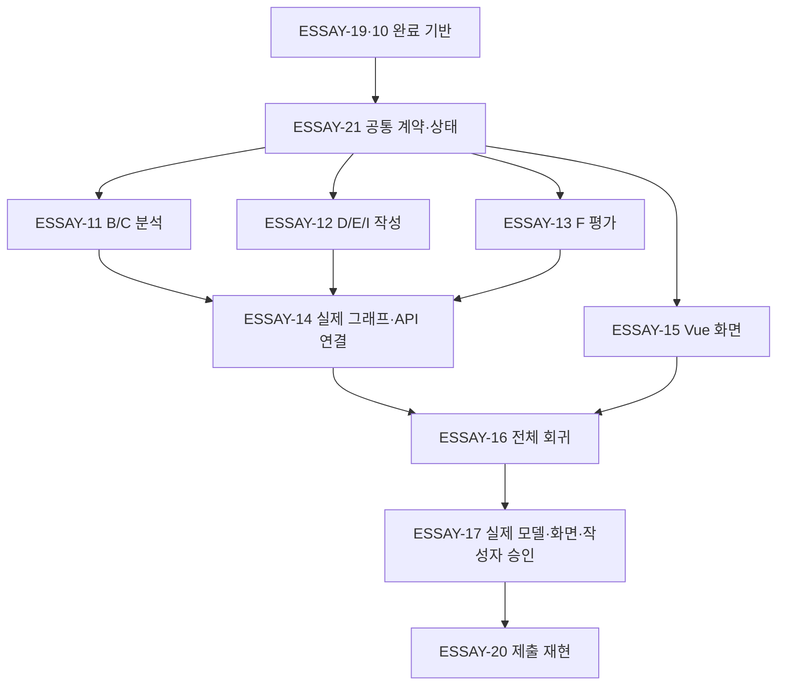

# 병렬 개발과 통합 검증

- 결정일: 2026-10-20. 사용자 승인에 따라 후속 역할을 병렬로 구현할 수 있게 선행 관계를 변경한다.
- [백로그](BACKLOG_V2.md) · [노드 최소 명세](NODE_MIN_SPEC.md) · [기술 설계](TECH_DESIGN_V2.md) · [QA](qa-v2.md)
- 2026-10-21 사용자 요청으로 ESSAY-11·12·13·15를 병렬 구현·검증하고 ESSAY-14에서 실제 역할을 연결했다. ESSAY-16의 Chrome 포함 통제 전체 회귀도 완료했다. [QA](qa-v2.md)에 독립 모듈/통합 증거를 기록했다. ESSAY-17·20은 후속 범위다.

## 실행 순서

Jira Blocks는 ESSAY-11→12, ESSAY-12→13을 해제하고 ESSAY-21→12·13, ESSAY-11·12→14를 추가한다. 기존 ESSAY-13→14, 21→11·15, 14·15→16 및 완료된 기준선 선행은 유지한다. V2 선행 연결은20개에서22개로 바뀐다. 실제 읽기 확인은 jira-v2.json에 기록한다.

## 소유권과 완료 범위

| 작업 | 독립 소유 범위 | 병렬 개발 때 사용할 입력 |
| --- | --- | --- |
| ESSAY-21 | 공통 계약·내보내기·상태·예산·스키마 등록 | 기존 실제 조사 결과와 합성 계약 fixture |
| ESSAY-11 | analyze.py, B/C 개인 근거·합류 자료, 분석 테스트 | 공통 입력/근거 계약과 기존 조사 결과 또는 명시된 대역 |
| ESSAY-12 | D 계획 조립, write.py, I 부분 수정, 작성 테스트 | 검증된 FlowAnalysisResult/ResearchResult 합성 fixture |
| ESSAY-13 | review.py·validate_evidence.py, 평가 테스트 | WritingPlan/DraftEnvelope 합성 fixture와 오류 반례 |
| ESSAY-15 | web_chat.html·web_demo_server.py, 화면 테스트 | ready/needs_input/품질 오류의 공통 응답 fixture |
| ESSAY-14 | essay_graph.py·essay_collect.py·essay_route.py, server.py POST, 전체 연결 테스트 | 완료된11·12·13의 실제 모듈과 기존10 |

공통 계약·contracts.py·state.py·budget.py·설정 파일은 한 담당자가 소유하고 변경 요청을 모아 순차 반영한다. 역할 담당자가 공통 파일을 동시에 수정하지 않는다. 같은 파일을 수정해야 하는 작업은 소유권을 넘기거나 별도 worktree에서 작업해 통합한다.

11·12·13·15는 공통 계약 확정 뒤 서로의 구현 완료를 기다리지 않고 실행 가능한 모듈과 실제 단위/어댑터 검사를 만들었다. 대역의 사용 위치·명령·관찰 결과를 역할별 보고서에 기록했다. 각 역할의 완료는 해당 모듈의 계약/행동 검증 범위이며 전체 서비스 통과를 뜻하지 않는다. 실제 역할 연결 검증은14, 화면을 포함한 회귀는16, 실모델/사실성 승인은17에서 완료한다. 이를 역할 티켓의 선행으로 다시 걸어 순환 의존성을 만들지 않는다.

검증 시나리오/README 초안 작성은 구현과 병행할 수 있으나 ESSAY-16·17·20의 실행/완료 조건은 선행 완료 후 충족해야 한다. 새 역할에서 사용하는 공개 타입·합성 fixture·필수 guard 호출은 ESSAY-21 인계 자료를 따른다. 합성 fixture를 실제 자기소개서/회사 자료/모델 실행 결과로 소개하지 않는다.

동시 실행은 리더1명·작업자3명 범위에서 배치한다. 분석·작성·평가·화면 네 작업 중 세 개를 먼저 맡기고 빈 담당자에게 다음 작업을 인계할 수 있다. 모든 후속 작업은 사용자가 지정한 범위만 시작한다.
