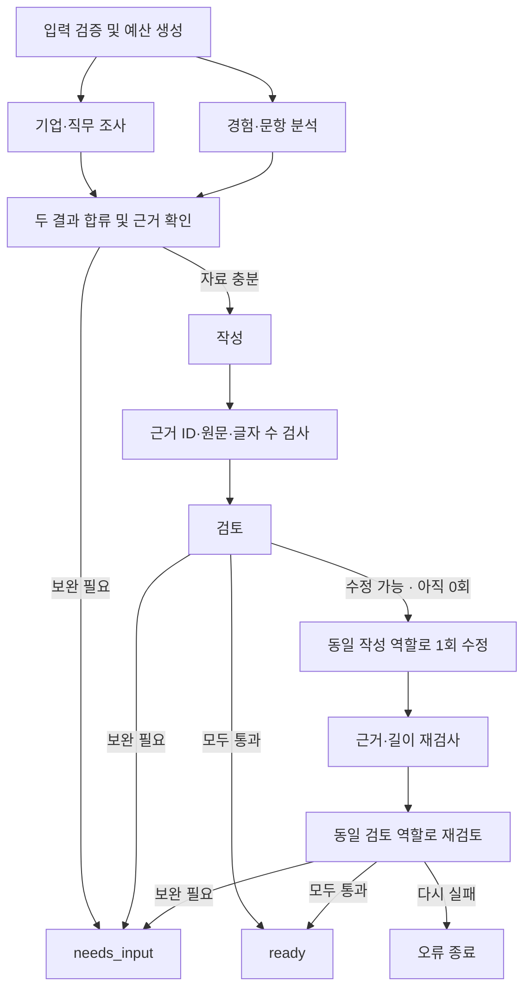

# 자소서 서비스 v2 기술 설계 — LangGraph 네 역할

- 작성일: 2026-10-19 / 상태: ESSAY-9 공통 기반 구현, 후속 역할·API·화면 미구현
- [v2 PRD](PRD_V2.md) · [백로그](BACKLOG_V2.md) · [도입 결정](decisions/langgraph-v2.md)
- 현재 런타임과 `POST /api/drafts`는 [v1 설계](TECH_DESIGN.md)를 따른다.
- 구현된 공통 기반: `src/shared/contracts-v2.ts`, `src/server/workflow/state.ts`, `budget.ts`, `providers.ts`, `native-provider.ts`, `provider-schemas.ts`. LangGraph 1.5.1, LangChain core 1.2.18, Zod 4.6.7을 고정했다.
- 아래 전체 그래프·API·화면·`DRAFT_PIPELINE_VERSION`은 후속 구현 목표다. StateGraph 실행 검사는 공통 상태의 실제 라이브러리 호환성 검사이며 제품 네 역할의 완성을 뜻하지 않는다.

## 1. 실행 구조

Next.js/TypeScript 서버에 LangGraph JS의 StateGraph를 둔다. 네 역할은 별도 지시·입출력 계약을 갖는 모델 노드이며 같은 기반 모델을 사용할 수 있다. 도구 선택과 반복을 자유롭게 맡기지 않고 코드에서 분기·호출 수·종료를 통제한다.



모든 단계의 제공자 실패·시간 초과·취소·형식 오류는 오류 종료로 이어진다. 도표의 수정 노드는 새로운 다섯 번째 역할이 아니라 같은 작성 역할의 두 번째 호출이다. 조사는 수정 시 재실행하지 않는다.

## 2. 역할과 구조화 출력

| 역할 | 입력 | 출력 |
| --- | --- | --- |
| 기업·직무 조사 | 기업·직무, 선택 공고 URL/본문 | resolvedCompany, sources, companyFacts, jobRequirements, gaps |
| 경험·문항 분석 | 문항·경험 | questionRequirements, experienceEvidence, gaps |
| 작성 | 원래 네 입력, 두 역할의 검증 결과, 수정 시 기존 초안·검토 지적·실제 길이 | draft, claimMap, fitReasons |
| 검토 | 초안, claimMap, 원문, 회사 근거, 문항 요구, 결정적 검사 결과 | verdict, issues, revisionInstructions |

조사 결과와 경험 분석 결과는 서로 다른 상태 필드에 기록한다. 합류는 두 결과가 모두 도착했을 때 한 번만 진행한다. 한 분기가 실패하거나 보완이 확정되면 다른 분기에서 새 작업을 시작하지 않으며 가능한 진행 작업을 취소한다.

공통 상태는 requestId, inputSnapshot, research, analysis, draft, claimMap, deterministicChecks, review, revisionCount(0|1), usage, deadline, outcome을 가진다. 상태는 요청 메모리에 한정하고 DB/checkpointer로 경험을 영구 저장하지 않는다. 병렬 노드가 동일한 입력/예산을 임의로 덮어쓸 수 없게 reducer와 예산 예약을 분리한다.

## 3. 근거 계약

- `Source`: id, kind(official|user_provided), title, url?(본문만 제공하면 없음), checkedAt(ISO 시각), publishedAt?/closingAt?(자료에 실제 있을 때만), excerpt. URL을 읽은 기록과 근거 구절이 없는 공식 출처는 수용하지 않는다.
- `CompanyFact/JobRequirement`: id, text, sourceIds. 회사의 가치와 직무 요구를 별도로 분류한다. 회사 식별·공식 채용 플랫폼 연결도 출처로 남긴다.
- `ExperienceEvidence`: id, quote, start, end, category(action|result|learning|context). start/end는 원본 experience의 JavaScript 문자열 UTF-16 위치이며 `experience.slice(start,end) === quote`를 검증한다. 글자 수 계산 규칙과 혼동하지 않는다.
- `Claim`: id, text(초안 내 실제 구절), kind(user_fact|company_fact|interpretation|future_plan), evidenceIds. 사실은 근거가 필수이고 해석/계획은 이미 한 일로 표현할 수 없다.
- `ReviewIssue`: code, claimIds, reason, action(revise|needs_input). 없는 ID·변조 인용·원문에 없는 과거 사실 문장을 결정적으로 거부하고 의미적 과장은 검토 모델과 최종 사람이 대조한다.
- `fitReasons`: experienceEvidenceIds + jobRequirementIds + 연결 이유. 인재상 키워드를 끼워 넣는 것만으로 적합성을 인정하지 않는다.

과거 사실 문단은 원문의 완전한 문장을 선택해 표현과 순서를 보존한다. 새로운 문장은 별도 현재 해석·미래 계획 문단에서만 허용한다. 검토 모델 통과가 모든 사실을 증명하지는 않는다.

## 4. 조사 어댑터

ESSAY-9의 실연결 검사와 사용자 결정으로 OpenAI Responses 내장 `web_search`를 선택했다. 기존 `OPENAI_API_KEY`, `OPENAI_MODEL=gpt-5.6-terra`를 사용하며 추가 검색 키는 필요 없다. `native-provider.ts`는 구조화 출력과 내장 검색을 한 모델 요청으로 실행한다. 조사 입력은 기업·직무·선택 공고 URL/본문으로 투영하여 문항·경험 필드를 제거한다. 검색어에는 기업·직무만 사용하도록 지시한다. 일반 모델 어댑터는 도구 없이 사용하며 별도 `SearchProvider`/`PageReader` 주입 인터페이스도 유지한다.

내장 응답의 검색 행동·출처 URL은 `verification: unverified`인 후보 자료다. 공식 기업 식별, 출처 연결과 근거 구절 검증은 ESSAY-10에서 구현한다. 구조화 출력의 선택 필드는 제공자용 required/nullable 스키마로 변환한 뒤 도메인의 선택 값으로 정규화한다. 호환성 증거와 SDK 필드 처리 이유는 [ADR](decisions/langgraph-v2.md)에 기록했다.

- 공식 도메인과 공식 페이지에서 연결된 채용 플랫폼의 신원을 검증한다. 검색 요약만으로 공식 확인을 완료하지 않는다.
- 문항·경험을 외부 검색 요청에 포함하지 않는다.
- 공통 URL은 HTTP(S)만 허용한다. 향후 직접 읽기 어댑터는 DNS/IP 및 모든 리다이렉트에서 loopback·사설망·link-local·클라우드 메타데이터 주소를 차단해야 한다. ESSAY-9에는 직접 네트워크 페이지 읽기 구현이 없다.
- 직접 읽기 경로는 페이지당 최대 1 MiB, 모델에 전달할 정리된 조사 텍스트 합계 12,000 코드 포인트로 제한한다. 내장 검색이 내부에서 읽는 페이지 수·바이트는 앱에서 강제할 수 없으며 이 상한의 검증 대상으로 간주하지 않는다. 인증 우회 없이 접근 불가를 처리한다.
- 페이지 속 명령과 사용자 자료는 신뢰하지 않는 데이터다. 검색 결과로 실행 도구·예산·비밀 접근 권한을 바꾸지 않는다.
- 기업 식별 모호 또는 직무 근거 없음 → needs_input. 인재상만 없음 → 생략. 제공자 장애/파싱 실패 → error. 사용자 제공 본문만 활용하면 그 한계를 명시한다.

## 5. 호출·시간 예산

| 항목 | 상한/규칙 |
| --- | --- |
| 모델 호출 | 정상 4회(조사·분석·작성·검토), 수정 포함 최대 6회 |
| 모델 호출당 | 최대 30초, 남은 요청/단계 시간보다 길게 설정하지 않음 |
| 조사 전체 | 검색·읽기·모델 포함 최대 45초 |
| 요청 전체 | 최대 180초, 모든 노드와 도구가 같은 deadline 사용 |
| 클라이언트 | 195초, 자동 재요청 없음 |
| 기본 내장 검색 | 요청당 내장 도구 용량 2회 선예약, Responses `max_tool_calls=2` |
| 별도 주입 검색/직접 읽기 | 서버가 각각 호출하는 경로에만 검색 최대 2회·페이지 읽기 최대 3회 적용 |
| 모델 출력 토큰 | 조사/분석 각 3,000, 작성 4,000, 검토 2,000; 수정 포함 합계 최대 18,000 |
| 자동 재시도 | SDK·도구·LangGraph 모두 0회 |
| 수정 | 작성·검토 재호출 각 1회; 사실/문항/길이 모두 같은 수정 예산 |
| 영구 저장 | 경험·초안 영구 저장 및 외부 추적 전송 기본 비활성 |

상한은 성능 보장이나 비용 견적이 아니다. `runNativeResearch`는 전송 전에 모델 1회와 내장 도구 용량 2회를 원자적으로 예약한다. `nativeToolCallsReserved`는 예약량이며 실제 사용량·과금량이 아니다. 실제 응답의 `toolCallsReported`, actions와 서버가 반환한 제한은 별도로 기록한다. 사용하지 않은 예약량과 실패·취소된 요청의 예약량도 반환하지 않아 같은 요청에서 두 번째 내장 검색 모델 호출을 막는다. 일반 모델 및 별도 검색/읽기 예산도 실패·취소 후 환불하지 않는다.

내장 도구의 한 호출에 여러 검색어나 결과 URL이 포함될 수 있다. 앱은 그 내부 검색어·페이지 수를 독립적으로 제한하지 않는다. 이 변경은 2026-10-19 사용자가 승인했다. `searches`/`pageReads` 카운터가 0이어도 내장 검색을 하지 않았다는 뜻이 아니다. 조사 전체는 45초지만 내장 검색을 포함한 한 Responses 모델 호출은 남은 시간과 30초 중 작은 값으로 취소된다. SDK 자동 재시도는 0이다.

기존 v1의 최대 2회/브라우저 75초 규칙은 v1에만 적용한다. 선택 호스팅에서 180초 요청을 허용하는지 확인하고, 불가하면 이번 동기 API 설계를 조정한 뒤 구현한다. 지원되지 않는 시간 설정을 성공한 것으로 기록하지 않는다.

## 6. API 및 전환

새 엔드포인트: `POST /api/v2/drafts`. 기존 `POST /api/drafts`의 요청·응답은 유지한다.

```ts
type DraftRequestV2 = {
  company: string;
  role: string;
  question: string;
  experience: string;
  jobPostingUrl?: string;
  jobPostingText?: string;
};
```

필수 문자열은 trim 후 비어 있으면 400. 선택 값의 빈 문자열은 생략으로 정규화한다. 제한은 company 120, role 160, question 3,000, experience 12,000, jobPostingText 16,000 코드 포인트, URL 2,048 문자다. 네 입력의 내용 자체를 모델이 재해석해 변경하지 않는다.

최종 JSON 응답:
- `ready`: requestId, draft, characterCount, sources, evidence(필요한 근거·claimMap·fitReasons), reviewSummary("생성 당시 검토 통과"), usage(modelCalls, revisionCount). 모델의 숨은 추론은 반환하지 않는다.
- `needs_input`: requestId, message, missingFields, questions, reasonCode. 초안 없음, 길이 규칙 미적용. 기업/직무 모호, 경험 부족, 근거 부족을 구분한다.
- `error`: requestId, code, message. 초안·API 키·원문·제공자 원문 오류 없음.

상태 코드: ready/needs_input 200, 입력 오류 400, 비활성 v2 404, 수정 후 길이/품질 실패 422(`LENGTH_VALIDATION_FAILED`/`QUALITY_CHECK_FAILED`), 설정 오류 500, 모델/검색 응답 오류 502, 시간 초과 504. 모델이 추가 정보가 필요하다고 판단한 상황을 오류와 혼동하지 않는다.

`DRAFT_PIPELINE_VERSION=v1|v2`를 서버에서 읽어 화면에 사용할 버전을 전달한다. 기본 v1이며 v2 엔드포인트도 v2 활성 상태에서만 호출할 수 있다. QA용 v2 활성 환경에서 검증하고 V2-09 승인 후 운영 기본값을 전환한다. 브라우저로 비밀 설정을 전달하지 않는다.

하나의 HTTP 요청에서 최종 응답을 받는다. SSE·역할별 진행 이벤트는 이번 범위에 없다. 화면은 처리 중 표시를 제공하며 실제 이벤트가 없는 역할별 완료 표시를 만들지 않는다.

## 7. 검토·분량·실패 판정

1. 작성의 스키마와 claimMap을 검증하고, 기존 공통 함수로 LF 정규화한 Unicode 코드 포인트를 센다(공백 포함).
2. 검토 역할은 원문·출처와 대조한다. 모델 pass만으로 결정적 검사 실패를 무시할 수 없다.
3. 모든 검사 통과 및 801~1,000자 → ready.
4. 사용자 입력 보완이 필요 → needs_input.
5. 수정 가능하고 revisionCount=0 → 실제 글자 수·목표 900자·문제 목록을 작성 역할에 전달.
6. 수정 후 같은 결정적 검사와 검토를 거친다. 여전히 실패하면 422, 세 번째 작성 없음.
7. 파싱/제공자 장애에는 자동 수리·재시도를 하지 않는다. 재시도를 원하면 사용자가 새 요청을 명시적으로 시작한다.

원본 경험 문장을 문자열 자르기·패딩으로 변형해 길이를 맞추지 않는다. 근거 인용·URL·설명은 초안 본문 밖에 두어 characterCount에 섞지 않는다.

## 8. 화면과 관찰 정보

공고 URL/본문은 선택 항목으로 제공한다. 요청 당시 입력 스냅샷과 결과가 함께 유지되고, 실패/보완 시 현재 입력과 이전 결과를 보존한다. 생성 결과에 공식/사용자 제공 출처와 확인일, 직무 연결 이유를 표시한다. 링크는 안전한 HTTP(S)만 노출한다.

사용자가 초안을 수정하면 글자 수는 즉시 갱신하고 검토 표시를 “생성 당시 결과 기준, 수정 내용 미검토”로 바꾼다. 자동으로 모델을 재호출하지 않는다. 복사는 현재 편집 텍스트를 사용한다.

운영 진단은 requestId, 단계, 소요 시간, 호출/검색 횟수, 토큰, 종료 코드 중심으로 기록한다. API 키·원문 경험·초안·전체 웹본문을 로그에 남기지 않는다. QA 원문은 사용자가 승인한 시험 자료에 한해 별도 증거 폴더에 저장한다.

## 9. 소유권과 검증

공통 계약/설정은 V2-01, 조사·분석·작성·검토는 V2-02~05, 그래프/API는 V2-06, 화면은 V2-07, 회귀는 V2-08, 실제 연결·작성자 확인은 V2-09다. 각 파일은 한 구현 담당자가 수정하고 공유 계약 변경은 합의 후 순차 반영한다.

[QA 계획](qa-v2.md)에 분기, 입력·글자 수 경계, 출처/근거, 예산·취소, 실제 모델, 브라우저 검증을 분리한다. 완료된 v1 QA 문서·run-7 승인 자료는 수정하거나 v2 증거로 재분류하지 않는다.

설계 참고: [LangGraph JS workflows and agents](https://docs.langchain.com/oss/javascript/langgraph/workflows-agents). 네 역할/예산/출처 정책은 이 프로젝트의 결정이며 프레임워크 기본 보장으로 해석하지 않는다.

