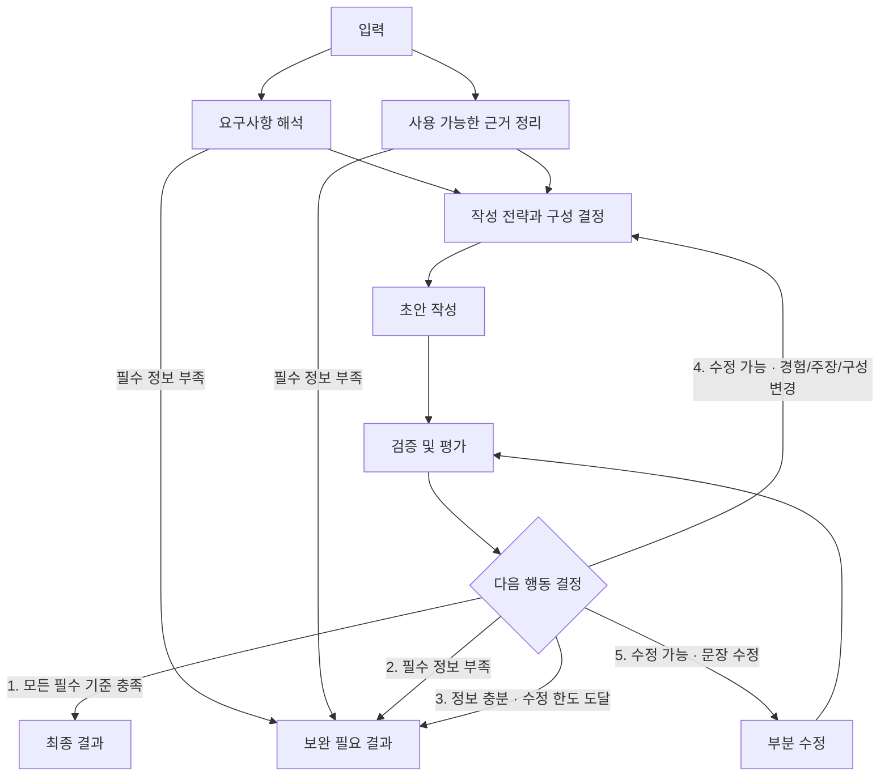

# 자소서 서비스 v2 기술 설계 — Python·MCP·Vue 전환

- 작성일: 2026-10-19 / 갱신: 2026-10-20 / 상태: ESSAY-18·19·10·21 완료. Python 공통 기반·조사 역할 검증 완료, 분석·작성·검토·전체 API·Vue 제품 화면은 후속 구현
- [v2 PRD](PRD_V2.md) · [백로그](BACKLOG_V2.md) · [전환 결정](decisions/provided-project-migration.md) · [보존·원본 대응](ASSIGNMENT_MIGRATION.md)
- 완료된 루트 Next.js의 `POST /api/drafts`는 [v1 설계](TECH_DESIGN.md)를 따른다. 별도 assignment 서버의 동명 업무 API는 ESSAY-14 후속 범위이며 현재404다.
- 구현된 공통 기반: `src/shared/contracts-v2.ts`, `src/server/workflow/state.ts`, `budget.ts`, `providers.ts`, `native-provider.ts`, `provider-schemas.ts`. LangGraph 1.5.1, LangChain core 1.2.18, Zod 4.6.7을 고정했다.
- 위 TypeScript 기반은 보존본이다. Python 공통 기반은 ESSAY-19에서 별도로 구현·검증했다. 아래 전체 서비스 흐름은 후속 구현 계약이며 네 역할 완성 증거가 아니다.
- 2026-10-20 사용자 A~J 흐름의 [노드별 최소 명세](NODE_MIN_SPEC.md)를 적용한다. 공통 계약 확장은 ESSAY-21에서 완료했고 [실제 계약 인계](FLOW_CONTRACTS.md)를 따른다. 내부 전략·평가 점수·세부 프롬프트는 후속 설계다.

### 구현된 Python 공통 기반

assignment/agent/contract_input.py·contract_evidence.py·contract_results.py를 contracts.py에서 내보낸다. state.py·deps.py는 새 요청 상태/예산과 타입 있는 의존성, budget.py·limits.py는 원자 예약/취소를 제공한다. openai_llm.py·provider_schema.py·response_wire.py는 strict wire 스키마와 SDK 응답을 검증한다. research.py·mcp_client.py·mcp_server.py는 실제 stdio 후보 조사 경계다. web/foundation.mjs는 LF/코드 포인트와 단일 HTTP 요청/취소 기반이다.

검증 환경은 CPython3.12.15, FastAPI0.150.0, LangGraph1.2.16, FastMCP4.1.1, MCP2.3.0, OpenAI3.35.1, Pydantic2.14.1, AnyIO4.15.1, uvicorn0.54.0이다. 전체 잠금은 assignment/uv.lock을 따른다. Python SDK는 httpx2를 사용한다. 기본 서버는 SQLite/legacy graph/chat을 열지 않고 /health에서 pipelineAvailable:false를 반환한다. /api/drafts는 ESSAY-14까지 404다.

모델 SDK/MCP는 lifespan마다 한 번 생성하며 요청마다 상태/예산을 새로 만든다. stdio keep_alive=false와 shielded 명시적 close로 자식을 정리한다. domain 입력과 _meta를 분리하며 표준 프로토콜 메타데이터5개만 제외한 후 내부 메타데이터를 검증한다. MCP REQUEST_TIMEOUT도 예산을 정지한다. 공식 OpenAI endpoint를 명시하고 inherited tracing을 비활성화한다. [ESSAY-19 보고서](qa-evidence/assignment/foundation/verification.md)에 실제 결과가 있다.

## 1. 실행 구조

제공된 Vue web_chat.html → FastAPI web_demo_server.py 프록시 → server.py → Python LangGraph agent/graph.py 구조를 활용한다. 모델/MCP 연결은 원본 deps.py와 lifespan 구조로 주입하고 상태·예산은 요청마다 새로 생성한다. 모델 역할은 조사·분석·작성·검토의 네 가지이며 같은 기반 모델을 사용할 수 있다. A~J는 논리적 책임으로 모델 호출과 일대일 대응하지 않는다. D의 최소 계획 조립과 G의 분기는 코드로 처리하며 호출 수·종료를 통제한다.



모든 단계의 제공자 실패·시간 초과·취소·형식 오류는 도표 밖의 공통 오류/취소 경로로 종료한다. J는 화면상 종료 지점이며 정보 부족은 needs_input 200, 정보 충분·수정 한도 소진은 품질 오류422로 구분한다. D 재계획과 I 부분 수정은 같은 작성 역할의 두 번째 호출을 사용하고 수정 기회1회를 공유한다. B/C와 조사는 수정 시 재실행하지 않는다. D 계획의 필수 정보 부족도 J로 종료한다.

## 2. 역할과 구조화 출력

| 역할 | 입력 | 출력 |
| --- | --- | --- |
| 기업·직무 조사 | 기업·직무, 선택 공고 URL/본문 | resolvedCompany, sources, companyFacts, jobRequirements, gaps |
| 경험·문항 분석(B/C의 개인 근거) | 문항·직무·경험 | 요구사항 ID/필수 조건, experienceEvidence, 연결 후보, gaps |
| 작성(E/I) | 원래 네 입력, 검증된 근거, D의 작성 계획, 수정 시 지적·허용 범위·버전 | DraftEnvelope: version, planVersion, draft, paragraphs(문단 ID/범위), claimMap, fitReasons |
| 검토(F) | 최신 초안/계획, claimMap, 원문, 회사 근거, 문항 요구, 코드 검사 | Evaluation: draftVersion, planVersion, criteria(7개 필수 기준), issues(기준/주장/문단·위치·scope·instruction·missingFields) |

조사 결과와 경험 분석 결과는 서로 다른 상태 필드에 기록한다. 합류는 두 결과가 모두 도착했을 때 한 번만 진행한다. 한 분기가 실패하거나 보완이 확정되면 다른 분기에서 새 작업을 시작하지 않으며 가능한 진행 작업을 취소한다.

현재 공통 상태는 requestId, inputSnapshot, research, analysis, draft, claimMap, deterministicChecks, review, revisionCount(0|1), usage, deadline, outcome을 가진다. ESSAY-21은 flow_analysis(요구사항·개인 근거), plan(WritingPlan), draft_envelope(DraftEnvelope), evaluation(EvaluationBinding), route, terminal_reason을 추가했다. 요구사항은 flow_analysis.requirements, 계획/초안 버전은 각 envelope가 단독 소유한다. D는 유효 근거·주장·요구사항 대응·문단 목적/순서/분량을 짧은 구조화 계획으로 조립하며 숨은 추론을 저장하지 않는다. flow_state.py가 원문·근거 종류/ID·문단/주장 범위와 버전을 대조한다. F 호출 직전 포착한 요청/계획/초안을 EvaluationBinding에 묶고 ready 직전에 require_ready_evaluation으로 다른 요청·버전·동일 버전 내용 변경·분량 실패를 차단한다. budget.reserve_revision은 D/I 공통 수정 기회를 한 번만 예약하며 RevisionReservationError를 기존 운영 예산 오류와 분리한다. 실제 분기/HTTP 응답 조립은 ESSAY-14다.

상태는 요청 메모리에 한정하고 DB/checkpointer로 경험을 영구 저장하지 않는다. 병렬 노드가 동일한 입력/예산을 임의로 덮어쓸 수 없게 reducer와 예산 예약을 분리한다. 최신 초안/계획 버전과 다른 평가 결과로 ready를 만들 수 없다. 필드별 계약·노드 소유권은 [최소 명세](NODE_MIN_SPEC.md)를 따른다.

## 3. 근거 계약

- `Source`: id, kind(official|user_provided), title, url?(본문만 제공하면 없음), checkedAt(ISO 시각), publishedAt?/closingAt?(자료에 실제 있을 때만), excerpt. URL을 읽은 기록과 근거 구절이 없는 공식 출처는 수용하지 않는다.
- `CompanyFact/JobRequirement`: id, text, sourceIds. 회사의 가치와 직무 요구를 별도로 분류한다. 회사 식별·공식 채용 플랫폼 연결도 출처로 남긴다.
- `ExperienceEvidence`: id, quote, start, end, category(action|result|learning|context). start/end는 LF 정규화한 experience의 Unicode 코드 포인트 위치다. Python 문자열 슬라이스와 Vue의 Array.from(text).slice(start,end).join("")가 quote와 같은지 검증한다. 기존 ESSAY-9 UTF-16 위치는 이식하지 않으며 한글·CRLF·이모지 fixture로 일치성을 확인한다.
- `Claim`: id, text(초안 내 실제 구절), kind(user_fact|company_fact|interpretation|future_plan), evidenceIds. 사실은 근거가 필수이고 해석/계획은 이미 한 일로 표현할 수 없다.
- `EvaluationIssue`: criterionId, claimIds, paragraphIds, start/end, reason, scope(missing_info|plan_or_claim|wording), instruction, missingFields를 사용한다. 기존 ReviewIssue는 호환성을 위해 보존한다. 없는 ID·변조 인용·원문에 없는 과거 사실 문장을 코드로 거부하고 의미적 과장은 검토 모델과 최종 사람이 대조한다.
- `fitReasons`: experienceEvidenceIds + jobRequirementIds + 연결 이유. 인재상 키워드를 끼워 넣는 것만으로 적합성을 인정하지 않는다.

과거 사실 문단은 원문의 완전한 문장을 선택해 표현과 순서를 보존한다. 새로운 문장은 별도 현재 해석·미래 계획 문단에서만 허용한다. 검토 모델 통과가 모든 사실을 증명하지는 않는다.

## 4. 조사 어댑터

ESSAY-9의 기존 키·OpenAI Responses 내장 web_search 선택은 유지한다. OPENAI_API_KEY·OPENAI_MODEL은 서버 설정에서 읽으며 Python 어댑터의 지원 여부는 ESSAY-19의 작은 실제 연결로 확인했다. 원본 MCPClient/stdio 구조를 활용해 mcp_server.py에 research_company_role 도구를 구현한다. 조사 노드는 이 도구를 호출하고 MCP 서버 내부가 구조화 출력+검색을 한 Responses 요청으로 실행한다. 조사 결과를 요약하는 추가 모델 호출은 없다.

FastAPI 요청 예산이 MCP 전송 전에 모델1/내장용량2를 원자 예약한다. 서버가 계산한 남은 timeout과 requestId를 전달하고 MCP 서버는 남은 시간/30초 중 작은 값·max_tool_calls=2·재시도0을 적용한다. 사용자/모델이 예산을 정하지 못하게 도구 입력과 내부 실행 메타데이터를 분리한다. 취소 후 새 요청을 막고 가능한 MCP/제공자 요청을 취소하며 이미 발생한 비용 취소를 보장하지 않는다. 요청별 상관관계·예산과 MCP 공유 연결의 동시성은 테스트한다.

도메인 입력은 기업·직무·선택 공고 URL/본문만 허용하고 문항·경험은 제거한다. 검색어에는 기업·직무만 사용하도록 지시한다. 분석·작성·검토 모델은 도구 없이 실행한다. 기존 native-provider.ts는 정책 참고이며 Python 런타임에서 실행하지 않는다.

내장 응답의 검색 행동·출처 URL은 `verification: unverified`인 후보 자료다. ESSAY-10의 `ResearchNode`는 실제 MCP 후보를 `source_verify.py`에 전달하고 검증된 `ResearchResult` 또는 보완/오류만 반환한다. 경험·문항이 있는 `DraftRequest`를 받더라도 MCP에는 `ResearchInput`으로 투영한다. 원시 후보는 후속 작성 역할로 노출하지 않는다. 구조화 출력의 선택 필드는 제공자용 required/nullable 스키마로 변환한 뒤 도메인의 선택 값으로 정규화한다. 호환성 증거와 SDK 필드 처리 이유는 [과거 ADR](decisions/langgraph-v2.md)에 기록했다. Python의 동일 계약은 ESSAY-19에서 재검증했으며 MCP 연결 자체를 출처 공식성 검증으로 간주하지 않는다.

- 운영자가 검토한 기업별 정확한 이름/별칭·HTTPS 호스트를 등록한다. 초기 목록은 사용자 선택에 따른 네이버·카카오·OpenAI·Anthropic이다. 계열사를 자동 포함하지 않는다. 공식 페이지에서 실제 연결된 정확한 외부 공고만 승인하고 그 연결 근거도 source로 유지한다. 검색 요약만으로 공식 확인을 완료하지 않는다. [출처 신뢰 결정](decisions/official-source-trust.md)을 따른다.
- 문항·경험을 외부 검색 요청에 포함하지 않는다.
- `source_http.py`는 HTTP(S)와 포트80/443만 허용한다. 공개 DNS 응답 전체와 모든 리다이렉트를 검사해 loopback·사설망·link-local·메타데이터/전환 주소를 차단한다. 실제 연결도 검사한 숫자 IP로 고정하고 원래 Host/TLS SNI·인증서 검증을 유지한다. 환경 proxy·자동 redirect·자동 재시도를 사용하지 않는다.
- 직접 읽기는 요청3회·페이지당1MiB·검증기가 읽는 정리 텍스트 합계12000코드포인트로 제한한다. 리다이렉트도 요청 수에 포함한다. 내장 검색이 내부에서 읽는 페이지 수·바이트는 앱에서 강제할 수 없으며 이 상한의 검증 대상으로 간주하지 않는다. 인증 우회 없이 접근 불가를 처리한다.
- 페이지 속 명령과 사용자 자료는 신뢰하지 않는 데이터다. 검색 결과로 실행 도구·예산·비밀 접근 권한을 바꾸지 않는다.
- 기업 식별 모호 또는 직무 근거 없음 → needs_input. 인재상만 없음 → 생략. 제공자 장애/파싱 실패 → error. 사용자 제공 본문만 활용하면 그 한계를 명시한다.

본문 추출은 실행 가능한 페이지 스크립트를 실행하지 않고 표준 JobPosting JSON-LD를 자료로 파싱한다. 네이버 `/rcrt/view.do`의 단일 `card_wrap`에서 `card_title`이 동일 JobPosting 제목과 일치하고, 그 카드의 `detail_box` 안 `What You'll Do`/`Required Skills` 구역에 실제 인용이 있을 때 서버가 해당 원문 구역을 발췌로 만든다. 모델이 번역한 메타데이터를 출처로 승격하지 않는다. 개별 업무 항목에 직무명/제목을 반복시킬 필요가 없다. 다른 형식은 기존 엄격한 인용 검사를 통과하거나 보완으로 끝난다. 직무와 고용주는 같은 공고에 연결돼야 한다. 일반 문화 글·전역 내비게이션·회사 필터는 공고 증거가 아니다. 사용자 본문은 서버 소유 `user-posting` source로 만들며 실제 원문에 있는 직무 요건만 수용한다. 짧은 인용은 같은 LF 줄의 요청 직무명·명시적 요건 표시·콜론 뒤 값 전체와 정확히 같아야 한다. 부정/조건을 잘라내거나 다른 줄의 직무명을 빌려올 수 없다. 사용자 원문과 인용의 공백은 그대로 보존하며, 공식 페이지 인용만 연속 공백을 정리해 대조한다. 서버의 확인 시각을 기록하고 후보가 지어낸 게시/마감일은 전달하지 않는다. 제한된 명시적 상충 검사와 원문 일치 검사는 모든 의미적 모순이나 현재 모집 여부의 증명이 아니다. 최종 수행 결과는 [ESSAY-10 보고서](qa-evidence/assignment/research/verification.md)에 기록한다.

## 5. 호출·시간 예산

| 항목 | 상한/규칙 |
| --- | --- |
| 모델 호출 | 정상 4회(조사·분석·작성·검토), 수정 포함 최대 6회 |
| 논리 노드 배치 | B/C 개인 근거는 분석1회 공유, D 계획 조립·G 분기는 코드, E/I는 같은 작성 역할 |
| 모델 호출당 | 최대 30초, 남은 요청/단계 시간보다 길게 설정하지 않음 |
| 조사 전체 | 검색·읽기·모델 포함 최대 45초 |
| 요청 전체 | 최대 180초, 모든 노드와 도구가 같은 deadline 사용 |
| 클라이언트 | 195초, 자동 재요청 없음 |
| 기본 내장 검색 | 요청당 내장 도구 용량 2회 선예약, Responses `max_tool_calls=2` |
| 별도 주입 검색/직접 읽기 | 서버가 각각 호출하는 경로에만 검색 최대 2회·페이지 읽기 최대 3회 적용 |
| 모델 출력 토큰 | 조사/분석 각 3,000, 작성 4,000, 검토 2,000; 수정 포함 합계 최대 18,000 |
| 자동 재시도 | SDK·도구·LangGraph 모두 0회 |
| 수정 | D→E 또는 I 중 한 경로·재검토1회; 사실/문항/길이 모두 같은 수정 예산 |
| 영구 저장 | 경험·초안 영구 저장 및 외부 추적 전송 기본 비활성 |

상한은 성능 보장이나 비용 견적이 아니다. Python 공통 예산은 ESSAY-9의 runNativeResearch 정책을 이식해 MCP 전송 전에 모델 1회와 내장 도구 용량 2회를 원자적으로 예약한다. `nativeToolCallsReserved`는 예약량이며 실제 사용량·과금량이 아니다. 실제 응답의 `toolCallsReported`, actions와 서버가 반환한 제한은 별도로 기록한다. 사용하지 않은 예약량과 실패·취소된 요청의 예약량도 반환하지 않아 같은 요청에서 두 번째 내장 검색 모델 호출을 막는다. 일반 모델 및 별도 검색/읽기 예산도 실패·취소 후 환불하지 않는다.

D를 별도 모델로 만드는 정책은 이번 범위에 없다. 별도 호출로 바꾸면 최초5회·구성 재작성 최대8회까지 필요하므로 호출/토큰/deadline·계약·QA를 먼저 별도로 변경해야 한다. 현재4/6회·180초 상한을 문서에서만 늘리지 않는다.

내장 도구의 한 호출에 여러 검색어나 결과 URL이 포함될 수 있다. 앱은 그 내부 검색어·페이지 수를 독립적으로 제한하지 않는다. 이 변경은 2026-10-19 사용자가 승인했다. `searches`/`pageReads` 카운터가 0이어도 내장 검색을 하지 않았다는 뜻이 아니다. 조사 전체는 45초지만 내장 검색을 포함한 한 Responses 모델 호출은 남은 시간과 30초 중 작은 값으로 취소된다. SDK 자동 재시도는 0이다.

기존 v1의 최대 2회/브라우저 75초 규칙은 v1에만 적용한다. Mac FastAPI·프록시에서 180초 요청을 허용하는지 확인하고, 향후 호스팅할 경우 그 환경도 확인하며, 불가하면 이번 동기 API 설계를 조정한 뒤 구현한다. 지원되지 않는 시간 설정을 성공한 것으로 기록하지 않는다.

## 6. API 및 전환

전환 서버의 엔드포인트: `POST /api/drafts`. 별도 포트의 assignment FastAPI 경로이며 기존 Next.js의 동명 API는 변경하지 않는다. 원본의 /chat와 GET /chat/stream은 baseline 관찰용이고 자기소개서 입력 경로로 사용하지 않는다.

```json
{
  "company": "기업명",
  "role": "직무",
  "question": "문항",
  "experience": "경험",
  "jobPostingUrl": "https://example.com/job",
  "jobPostingText": "선택 공고 본문"
}
```

뒤의 두 공고 필드는 선택이다. Python Pydantic 계약으로 검증하며 예시는 실행 결과가 아니다.

필수 문자열은 trim 후 비어 있으면 400. 선택 값의 빈 문자열은 생략으로 정규화한다. 제한은 company 120, role 160, question 3,000, experience 12,000, jobPostingText 16,000 코드 포인트, URL 2,048 문자다. 네 입력의 내용 자체를 모델이 재해석해 변경하지 않는다.

최종 JSON 응답:
- `ready`: requestId, draft, characterCount, sources, evidence(필요한 근거·claimMap·fitReasons), reviewSummary("생성 당시 검토 통과"), usage(modelCalls, revisionCount). 모델의 숨은 추론은 반환하지 않는다.
- `needs_input`: requestId, message, missingFields, questions, reasonCode. 초안 없음, 길이 규칙 미적용. 기업/직무 모호, 경험 부족, 근거 부족을 구분한다.
- `error`: requestId, code, message. 초안·API 키·원문·제공자 원문 오류 없음.

상태 코드: ready/needs_input 200, 입력 오류 400(FastAPI 기본 요청 검증 422도 400으로 정규화), 수정 후 길이/품질 실패 422(`LENGTH_VALIDATION_FAILED`/`QUALITY_CHECK_FAILED`), 설정 오류 500, 모델/검색 응답 오류 502, 시간 초과 504. J의 필수 정보 부족에는 실제 missingFields/questions를 제공하고, 정보 충분·수정 한도 소진에는 이를 지어내지 않고422로 끝낸다. 파싱/운영 오류를 J의 정보 부족이나 품질 실패로 바꾸지 않는다.

루트 Next.js와 assignment는 독립 실행한다. Next.js /api/v2/drafts·DRAFT_PIPELINE_VERSION 추가 계획은 대체됐으며 기존 v1 기본값을 바꾸지 않는다. assignment/의 run.sh·빈 환경설정 예시·README는 ESSAY-19에서 실제 설치·실행을 확인했다. 전체 제품 시연·제출 검증은 ESSAY-20에서 완성한다. 원본의 SQLite 대화 저장과 외부 tracing은 제출 경로에서 기본 비활성화하고 전체 프롬프트를 응답에 포함하지 않는다.

하나의 HTTP 요청에서 최종 응답을 받는다. SSE·역할별 진행 이벤트는 이번 범위에 없다. 화면은 처리 중 표시를 제공하며 실제 이벤트가 없는 역할별 완료 표시를 만들지 않는다.

## 7. 검토·분량·실패 판정

1. F는 최신 초안의 계약/근거·개인 사실·회사 사실·필수 문항·직무 연결·분량·해석/계획 구분을 모두 평가한다. 모델 pass는 코드 검사 실패를 덮을 수 없다.
2. G1: 모든 필수 기준 및801~1,000자 통과 → H ready. 수정 횟수1에서도 먼저 통과를 확인한다.
3. G2: 필수 정보 부족 → J needs_input. B/C에서 확정하면 작성 전에 종료한다.
4. G3: 정보 충분·미통과·revisionCount=1 → J 품질/길이 실패422.
5. G4: 정보 충분·revisionCount=0·경험/주장/구성 변경 필요 → 공통 수정 기회 예약 → D/E → F.
6. G5: 정보 충분·revisionCount=0·허용 문장 변경만 필요 → 같은 수정 기회 예약 → I → F. 지적이 섞이면 G4를 우선한다.
7. I는 계획·사실 원문을 고정하고 문단/주장 ID와 버전이 유효한 범위만 수정한다. 수정 후 전체 초안과 claimMap을 재평가한다. E/I 이전의 검토 결과는 재사용하지 않는다.
8. 재평가 뒤 G를 다시 실행한다. 수정 횟수 초기화·D/I 연속 사용·세 번째 작성·강제 통과는 없다. 파싱/제공자 장애·timeout은 별도 오류로 끝내며 자동 수리·재시도를 하지 않는다.

원본 경험 문장을 문자열 자르기·패딩으로 변형해 길이를 맞추지 않는다. 근거 인용·URL·설명은 초안 본문 밖에 두어 characterCount에 섞지 않는다.

## 8. 화면과 관찰 정보

공고 URL/본문은 선택 항목으로 제공한다. 요청 당시 입력 스냅샷과 결과가 함께 유지되고, 실패/보완 시 현재 입력과 이전 결과를 보존한다. 생성 결과에 공식/사용자 제공 출처와 확인일, 직무 연결 이유를 표시한다. 링크는 안전한 HTTP(S)만 노출한다.

사용자가 초안을 수정하면 글자 수는 즉시 갱신하고 검토 표시를 “생성 당시 결과 기준, 수정 내용 미검토”로 바꾼다. 자동으로 모델을 재호출하지 않는다. 복사는 현재 편집 텍스트를 사용한다.

운영 진단은 requestId, 단계, 소요 시간, 호출/검색 횟수, 토큰, 종료 코드 중심으로 기록한다. API 키·원문 경험·초안·전체 웹본문을 로그에 남기지 않는다. QA 원문은 사용자가 승인한 시험 자료에 한해 별도 증거 폴더에 저장한다.

## 9. 소유권과 검증

[병렬 개발 기준](PARALLEL_DEVELOPMENT.md)에 따라 공통 계약 확정 후 ESSAY-11·12·13·15는 합성 fixture와 실제 각 모듈로 병렬 검증한다. ESSAY-14는11·12·13 완료 후 실제 모듈을 연결하고 ESSAY-16은14·15 완료 후 전체를 검증한다. 같은 공통 파일을 여러 담당자가 동시에 수정하지 않는다.

원본 실행은 ESSAY-18, Python 공통 계약/설정은 ESSAY-19(V2-01은 보존된 TypeScript 기준선), 새 계획·평가·분기 계약 확장은 ESSAY-21이다. 기존 조사는 ESSAY-10(C 기업 근거), 분석은 ESSAY-11(B/C), 계획·작성·부분 수정은 ESSAY-12(D/E/I), 평가는 ESSAY-13(F), 그래프/API는 ESSAY-14(A/G/H/J), 화면은 ESSAY-15, 회귀는 ESSAY-16, 실제 연결·작성자 확인은 ESSAY-17, 제출물은 ESSAY-20이다. 각 파일은 한 구현 담당자가 수정하고 공통 계약 소유권을 순차 인계한다.

[QA 계획](qa-v2.md)에 분기, 입력·글자 수 경계, 출처/근거, 예산·취소, 실제 모델, 브라우저 검증을 분리한다. 완료된 v1 QA 문서·run-7 승인 자료는 수정하거나 v2 증거로 재분류하지 않는다.

이전 LangGraph JS 선택 근거는 과거 ADR에 보존한다. Python 구현 시 설치된 라이브러리와 공식 문서로 실제 API를 확인한다. 네 역할/예산/출처 정책은 프로젝트 계약이며 프레임워크 기본 보장으로 해석하지 않는다.

